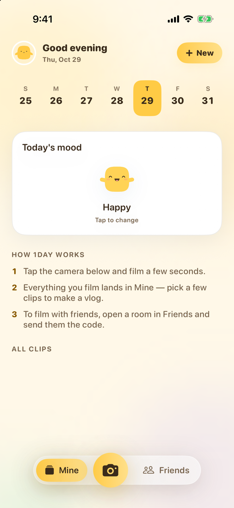
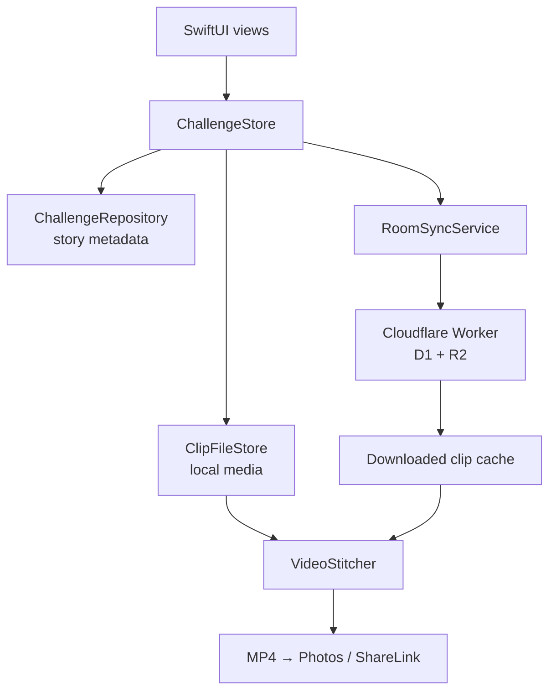

# 1Day

**English** · [中文](README.zh-CN.md)

**Film a few seconds a day. Make it a vlog.**

1Day is an iOS app for short daily video clips. Tap the camera and it films a
two-second take; every clip is saved to **Mine**, sorted by day, with a
calendar. Pick a few clips and make them into a vlog. You can also open a room
with up to 6 friends, send clips to it, and tap a friend's face to watch their
day.

[Website](https://1day.liangyue.site) · [中文官网](https://1day.liangyue.site/zh) · [App Store](https://apps.apple.com/cn/app/1-day/id6794565199?uo=4) · [TestFlight](https://testflight.apple.com/join/cRQm6Va2) · [App release notes](https://1day.liangyue.site/updates)

<p align="center">
  
  &nbsp;&nbsp;
  
</p>

Real app UI from a simulator build, with demo data (the people and clips are
not real users). Both screenshots were taken just before the tab labels were
renamed, so the bottom bar reads "Mine / Friends"; in the current code the two
tabs are **Camera** and **Rooms**.

## Status

- **Repository / development version: 1.5 (build 35)**, from
  [`ios/project.yml`](ios/project.yml).
- **1.5 is a TestFlight beta.** Per the
  [release notes](https://1day.liangyue.site/updates) it is not yet on the App
  Store. The last App Store version recorded here is **1.1** (released August
  25, 2026, checked September 8, 2026); this README does not claim a newer one.
- The newest builds go out through [TestFlight](https://testflight.apple.com/join/cRQm6Va2).

## What the app does (1.5)

Two tabs, **Camera** and **Rooms**. Your personal library, **Mine**, opens from
Rooms.

- **Camera.** One tap films a two-second take that stops on its own. Front and
  rear cameras, zoom, and a camcorder look with the date printed on the picture.
  On iPhones that support multi-camera capture, front and back can film at once.
  A take you have not filed yet can be kept as a draft.
- **Mine.** Every clip you film, grouped by day, with a calendar to jump to a
  day. Select a few clips and make a vlog. Each day carries that day's mood.
- **Plans and mood.** A week calendar on top. Pick one of five moods for today,
  write today's list, import it from Reminders (read-only), or have AI draft the
  list from one sentence. Past days can generate a recap.
- **Rooms.** Create a room and share its six-character code; a room holds up to
  6 people. Each member gets a clip card. Tap an avatar to watch that person's
  clips for the day, and use the calendar button to pick the day. Rooms have
  chat, emoji reactions, comments, and pokes for friends who have not filmed
  yet. You choose which rooms each clip is sent to; a clip you do not send is
  only visible to you.
- **Vlogs.** Choose and order clips, then make a vlog. A room vlog can put
  several people in one frame. Sound: original audio, music (six bundled
  tracks), or a mix. A look panel adjusts softness, brightness, and warmth.
  Rendering happens on the device; save to Photos or share the MP4.
- **Avatars and accounts.** Pick a photo or a little character as your avatar.
  Sign in with Apple or Google (needed for rooms). Leaving a room removes your clips, reactions, comments, and member
  record there; deleting your account removes your rooms and clips from the
  cloud.
- **Notifications.** Push alerts for room activity, sent by the Worker through APNs.
- **Languages.** English and Simplified Chinese.

### Earlier versions

Through 1.1 the app was built around choosing a theme and following moment
prompts, with one- and seven-day stories. 1.5 removed the theme and template
chooser: new plans and rooms are just a name (and a list, for plans). Some
older types and assets for that flow remain in the code so existing stories and
clips still open; they are not the current journey. The release notes keep the
history.

## Architecture



- **On-device rendering.** `VideoStitcher` builds an AVFoundation composition
  (tracks, audio mix, Core Animation overlays) and exports an MP4 without a
  render server.
- **Backend: Cloudflare Worker.** [`workers/api`](workers/api) holds rooms,
  members, clips, reactions, chat, pokes, and the mood diary in D1; videos and
  avatars in R2; push goes to APNs. It is served at `auth.liangyue.site`. Every
  route needs a bearer token. Despite their names, files such as
  `CloudKitService.swift` talk to this Worker; the app moved off CloudKit, and
  `workers/api/scripts/migrate-cloudkit.mjs` moves old data across.
- **Idempotent clips.** A shared clip's ID is derived from room, participant,
  and slot, so re-recording updates the same record. The room code is the
  room's key; it is an invitation, not a secret.
- **AI to-do suggestions.** If you ask for a drafted list, the app sends your
  sentence, a count, the language, and a random installation ID to
  [`workers/suggest-prompts`](workers/suggest-prompts), which calls DeepSeek.
  It never receives your video.

## Tech stack

| Area | Implementation |
| --- | --- |
| App | Swift 5.9, SwiftUI, Observation, iOS 17+ |
| Capture | AVFoundation (including multi-camera capture where supported) |
| Rendering | AVMutableComposition, AVVideoComposition, AVAudioMix, Core Animation |
| Backend | Cloudflare Worker (`workers/api`), D1, R2, APNs |
| Sign-in | Sign in with Apple, Google Sign-In |
| Persistence | Codable metadata, media on disk |
| Website | React 19, Vite 6, prerendered bilingual routes, Vercel |
| AI to-do suggestions | Cloudflare Worker (`workers/suggest-prompts`), DeepSeek |
| Project generation | XcodeGen |
| Tests | XCTest and XCUITest |

## Repository layout

```text
ios/
├── AISetlog/               # App source (SwiftUI)
│   ├── App/                # Entry point
│   ├── Models/             # Stories, clips, interactions (no display strings)
│   ├── Presentation/       # Pure presentation logic (no SwiftUI, no `.now`)
│   ├── Resources/          # Localization, music, theme
│   ├── Services/           # Cloud, media capture/rendering, persistence, notifications
│   └── Views/              # Plans/Mine, rooms, record, film, library, mood, avatar, settings
├── AISetlogTests/          # Unit tests
├── AISetlogUITests/        # UI tests
└── project.yml             # XcodeGen project definition
landing-page/               # React/Vite product site
workers/api/                # Backend: auth, rooms, clips, chat, push (D1 + R2)
workers/suggest-prompts/    # AI to-do suggestion service
android-app/                # Flutter prototype of the older flow (see below)
docs/                       # Product notes, beta protocol, assets
```

Contributor rules (layering, CI, commits) are in [AGENTS.md](AGENTS.md).

## Run the iOS app

Requirements: macOS, Xcode with the iOS 17 SDK or newer, and
[XcodeGen](https://github.com/yonaskolb/XcodeGen).

```bash
cd ios
xcodegen generate --spec project.yml
open AISetlog.xcodeproj
```

Run the `AISetlog` scheme on an iPhone or simulator. Re-run `xcodegen generate`
after adding, removing, or renaming source files; the `.xcodeproj` is not
checked in. Camera behavior and on-screen overlays on the finished film should
be checked on a physical device, since the simulator compiles some of that out.

Rooms need an Apple Developer team (Sign in with Apple and push entitlements)
and a reachable backend. The app talks to the Worker at `auth.liangyue.site`; to
run your own, deploy [`workers/api`](workers/api).

## Test

```bash
cd ios
xcodegen generate --spec project.yml
xcodebuild test \
  -project AISetlog.xcodeproj \
  -scheme AISetlog \
  -destination 'platform=iOS Simulator,name=<an installed iPhone simulator>' \
  CODE_SIGNING_ALLOWED=NO
```

Use any iPhone simulator you have installed (`xcrun simctl list devices
available`). CI ([`.github/workflows/ios-tests.yml`](.github/workflows/ios-tests.yml))
runs a layer-boundary check plus unit, UI, and shared-room lanes, and skips four
CloudKit-named suites that cannot run unsigned.

The Workers have their own tests:

```bash
cd workers/api && npm test
cd workers/suggest-prompts && npm test
```

## Run the landing page

Source: [`landing-page/`](landing-page). Production: [1day.liangyue.site](https://1day.liangyue.site).
Routes: `/` and `/zh`, `/updates` and `/zh/updates` (release notes), `/privacy` and
`/zh/privacy`.

```bash
cd landing-page
npm install
npm run dev
```

`npm run build` generates the client bundle and prerenders the routes;
`npm run preview` serves it. Screenshots and the illustrated demo film are in
`landing-page/public/assets`. Some images there are older than the current app
(for example `app-theme-*` and `app-film-*` no longer show the screens their
names suggest).

## Android

[`android-app/`](android-app) is a Flutter project (`1.0.0+1`, package
`com.cassie.one_day`) that follows the older one-day/seven-day template flow.
It is an offline prototype, not updated for 1.5, not linked from the website,
and its release APK is signed with the debug key. Treat it as unreleased.

## Beta testing

The testing protocol and privacy-safe results template are in
[docs/BETA_TESTING.md](docs/BETA_TESTING.md). The repository does not claim
adoption or completion metrics that have not been measured.

## License

[MIT](LICENSE)
