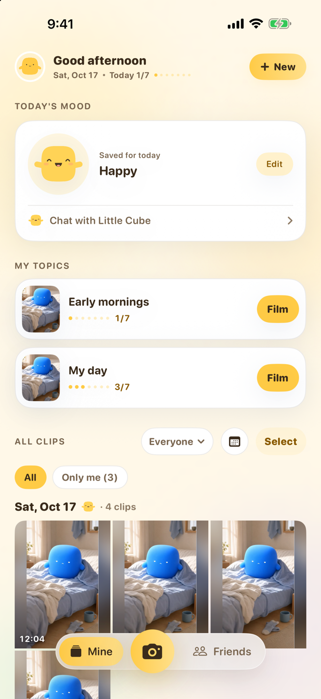
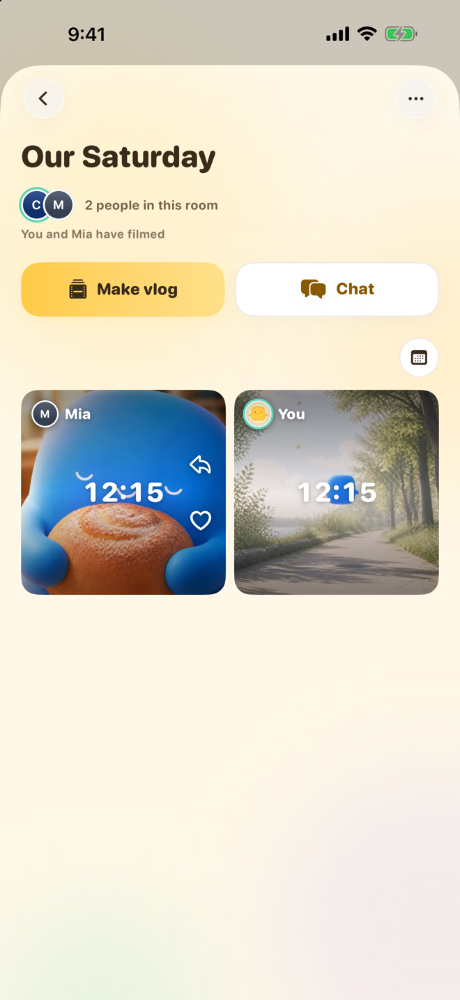
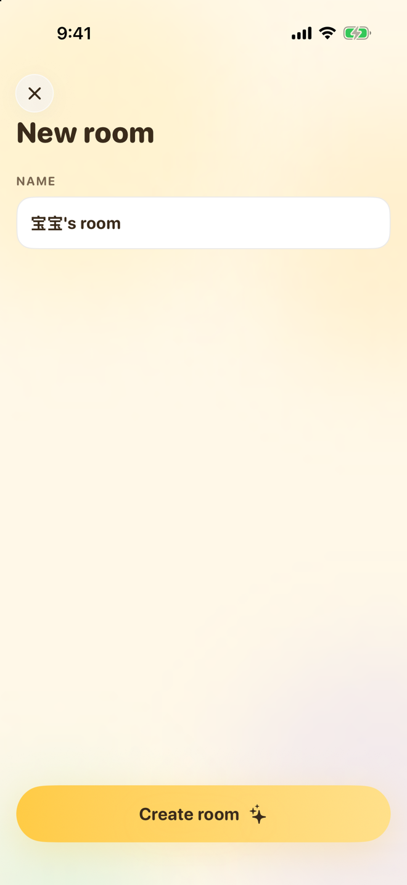
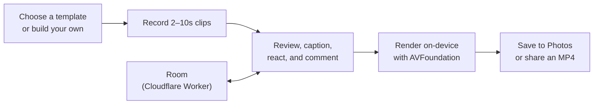
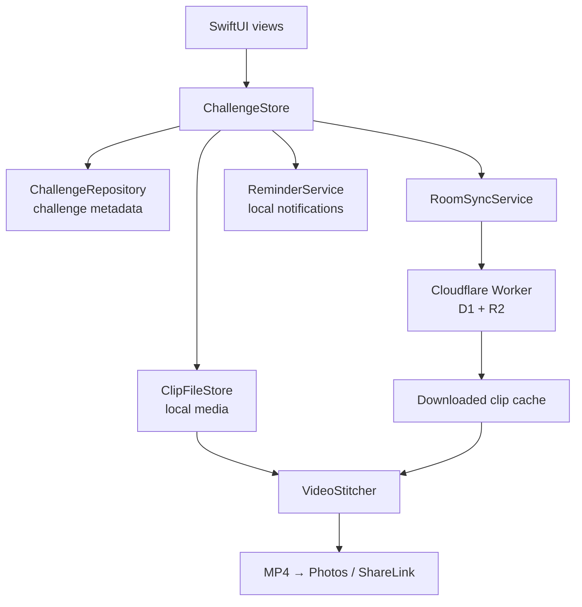

# 1Day

**Give today a theme. Live it your way, on your own or with friends, and turn it into a vlog.**

1Day starts with a question: **How do you want to spend today?** Choose a theme,
follow a few moment prompts, and capture the day on your own or with friends.
The finished vlog is your keepsake. The native iOS app supports one-day and
seven-day stories, with film assembly entirely on-device.

**Theme → Moments → Together → Film**

[Website](https://1day.liangyue.site) · [中文官网](https://1day.liangyue.site/zh) · [App Store](https://apps.apple.com/us/app/1-day/id6794565199) · [TestFlight](https://testflight.apple.com/join/cRQm6Va2) · [App release notes](https://1day.liangyue.site/updates)

<p align="center">
  
  &nbsp;&nbsp;
  
  &nbsp;&nbsp;
  
</p>

Real App UI captured in an isolated iOS Simulator build. Blue’s illustrated
story and the shared participants are demo data, not user footage or evidence
of a live multiplayer session.

## Version 1.5: rooms and your own day

The current development version (1.5, build 35) has two tabs, **Camera** and
**Rooms**. Your own timeline opens from the Rooms page.

- **Rooms.** Each member gets a clip card. Landscape rooms stack 16:9 cards;
  portrait rooms lay out a grid by head count. Tap an avatar to watch only that
  person's clips full-screen, stories style. A calendar button picks the day.
- **Chat and reactions.** Rooms have chat, emoji reactions, comments, and pokes.
  Push notifications show the chat text in the app's language.
- **Plans and mood.** A week calendar on Home shows each day's plan and mood.
  Write a plan, import it from Reminders, or have AI turn a sentence into a
  to-do list. Past days can generate a recap.
- **Film.** Drag clips into your own order for a room film. A gentle look adjusts
  softness, brightness, and warmth for playback and export. Mixed portrait and
  landscape clips sit on a blurred backdrop instead of being cropped.
- **Avatars.** Pick a photo or a little character; stickers crop to your face.
- **Accounts.** Sign in with Apple or Google. Leaving a room removes your clips,
  reactions, comments, and member record. Deleting your account removes your
  rooms and clips from the cloud.

1.5 is **not yet listed as released**. The latest App Store version verified on
September 8, 2026 was **1.1**, released August 25, 2026. Repository features may
be ahead of the store build; the newest builds go out through
[TestFlight](https://testflight.apple.com/join/cRQm6Va2).

## The idea

Most days are remembered through a few small moments, not one long recording.
1Day gives each moment a prompt, keeps every clip intentionally short, and does
the editing at the end. The result is a personal film without a camera roll full
of footage or an evening spent in a video editor.

## Product highlights

- **One day or seven.** Capture several moments today, or return for one clip a
  day over a week.
- **Guided or personal.** Start from bilingual themes, create your own prompts,
  or record by time without a prompt sequence.
- **Short by design.** Choose 2, 5, or 10-second clips and lock the challenge to
  portrait or landscape.
- **Made with friends.** Create a room, invite people with a six-character
  code, and collect everyone’s clips in one shared story.
- **More than a clip feed.** Friends can leave emoji reactions and comments;
  those interactions can appear in the final film.
- **A real camera workflow.** Switch between front and rear cameras, review a
  take, add overlay text, or re-record the same moment.
- **Automatic editing.** AVFoundation assembles clips with audio, crossfades,
  title cards, prompt captions, names, dates, reactions, and comments.
- **Your film, your choice.** Preview the result, adjust its title card, captions,
  and transition length, then save it to Photos or share the MP4.
- **Local-first.** Solo challenges need no account or backend. Shared rooms need
  a signed-in account.
- **Room alerts.** Push notifications (APNs, sent by the Worker) announce new
  clips, chat, and reactions in your rooms.
- **English and Simplified Chinese.** Product copy, prompts, templates, and
  permission messaging follow the selected app language.

## How it works



## Engineering

### On-device media pipeline

`VideoStitcher` loads and normalizes each asset, preserves camera transforms,
builds alternating composition tracks, mixes audio through crossfades, and adds
Core Animation overlays through `AVVideoCompositionCoreAnimationTool`. Export
produces a shareable MP4 without sending personal footage to a render server.

The tradeoff: device media behavior is less predictable than a centralized
renderer. The implementation explicitly handles orientation, track lifetimes,
audio ranges, empty input, and simulator limitations.

### Local-first service boundaries

`ChallengeStore` owns observable app state but delegates storage and I/O:



This keeps the core flow usable offline and isolates persistence, collaboration,
notifications, capture, and rendering behind focused components.

### Backend: Cloudflare Worker

Rooms, members, clips, reactions, chat, pokes, and the mood diary live in D1;
videos and avatars live in R2; room alerts go straight to APNs. The app moved
off CloudKit to this Worker (`workers/api`, served at `auth.liangyue.site`).
Every route needs a bearer token, and the caller is always the author of what
they write. `workers/api/scripts/migrate-cloudkit.mjs` moves old CloudKit data
across. See [the Worker](workers/api) for routes and deploy steps.

### Idempotent collaboration

A shared clip’s ID is derived from `room + participant + slot`. Re-recording
updates the same record instead of creating a duplicate. The room code is the
room’s key, so joining is a direct fetch rather than a query. Codes are
convenient invitations, not security secrets.

### Backward-compatible state

Saved challenges use stable prompt keys and version-tolerant decoding. Legacy
English or Chinese prompt strings, older challenge defaults, and the original
single-challenge storage shape are migrated or resolved without discarding a
user’s clips.

### Optional prompt suggestions

The core solo recording flow stays on-device. If the user requests suggestions,
the app sends their sentence, prompt count, language, and a random installation
identifier to a separate Cloudflare Worker. The Worker uses DeepSeek to suggest
prompts; it does not receive the user’s video clips. Users can also write prompts
without calling this service. See [the Worker](workers/suggest-prompts) for configuration.

## Tech stack

| Area | Implementation |
| --- | --- |
| App | Swift 5.9, SwiftUI, Observation, iOS 17+ |
| Capture | AVFoundation (`AVCaptureSession`, `AVCaptureMovieFileOutput`) |
| Rendering | AVMutableComposition, AVVideoComposition, AVAudioMix, Core Animation |
| Collaboration | Cloudflare Worker (`workers/api`), D1, R2, APNs, Sign in with Apple, Google sign-in, deep links |
| Persistence | Codable metadata in UserDefaults, media on disk |
| Notifications | UserNotifications |
| Website | React 19, Vite 6, prerendered bilingual routes, Vercel |
| Optional prompt suggestions | Cloudflare Worker (`workers/suggest-prompts`), DeepSeek |
| Project generation | XcodeGen |
| Tests | XCTest with real MP4 export fixtures |

## Repository layout

```text
ios/
├── AISetlog/
│   ├── App/               # App entry point and lifecycle
│   ├── Models/            # Challenges, cards, clips, templates, interactions
│   ├── Presentation/      # Localized presentation logic
│   ├── Resources/         # Theme, localization, and media fixtures
│   ├── Services/
│   │   ├── Cloud/         # Worker API client, auth, and room synchronization
│   │   ├── Media/         # Camera capture and AVFoundation renderer
│   │   └── Persistence/   # Metadata repository and clip file store
│   └── Views/             # Home, plans, mood, record, film, rooms, avatar, settings
├── AISetlogTests/          # State, localization, migration, and export tests
└── project.yml             # XcodeGen project definition
landing-page/               # React/Vite product site
workers/api/                # Backend: auth, rooms, clips, chat, push (D1 + R2)
workers/suggest-prompts/    # Optional filming-prompt service
docs/                       # Product specs, beta protocol, and assets
```

## Run the iOS app

### Requirements

- macOS with Xcode and the iOS 17 SDK or newer
- [XcodeGen](https://github.com/yonaskolb/XcodeGen)

```bash
cd ios
xcodegen generate --spec project.yml
open AISetlog.xcodeproj
```

Select the `AISetlog` scheme and run it on an iPhone or iOS Simulator. The
simulator can exercise the product flow and export fixtures; camera behavior and
Core Animation render overlays should be verified on a physical device.

Shared rooms additionally require an Apple Developer team (Sign in with Apple
and push entitlements) and a reachable backend. The app talks to the Worker
at `auth.liangyue.site`; to run your own, deploy [`workers/api`](workers/api).

## Run the landing page

Source: [`landing-page/`](landing-page). The production site is
[1day.liangyue.site](https://1day.liangyue.site).

Routes: `/` and `/en` for the product site, `/updates` and `/en/updates` for
App release notes, and `/privacy` and `/en/privacy` for privacy information.


```bash
cd landing-page
npm install
npm run dev
```

For a production build and local preview:

```bash
npm run build
npm run preview
```

The build generates the client bundle and prerenders all six routes. App
screenshots and the illustrated demo film live in `landing-page/public/assets`.
The demo film has optional Chinese and English captions; below-the-fold images
load lazily and the video waits for playback before loading.

## Test

```bash
cd ios
xcodegen generate --spec project.yml
xcodebuild test \
  -project AISetlog.xcodeproj \
  -scheme AISetlog \
  -destination 'platform=iOS Simulator,name=iPhone 17' \
  CODE_SIGNING_ALLOWED=NO
```

The suite covers challenge and card state, localized prompt resolution, legacy
data decoding, account deletion, room sync and chat, avatars, mood, and playable
AVFoundation MP4 export with real media fixtures.

## Project status

1Day is available on the
[App Store](https://apps.apple.com/cn/app/1-day/id6794565199?uo=4). The testing
protocol and privacy-safe results template remain in
[docs/BETA_TESTING.md](docs/BETA_TESTING.md); the repository does not claim
adoption or completion metrics that have not been measured.

## License

[MIT](LICENSE)
