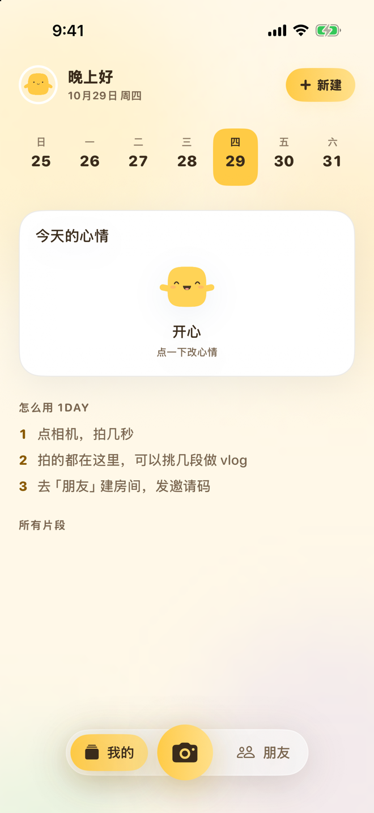
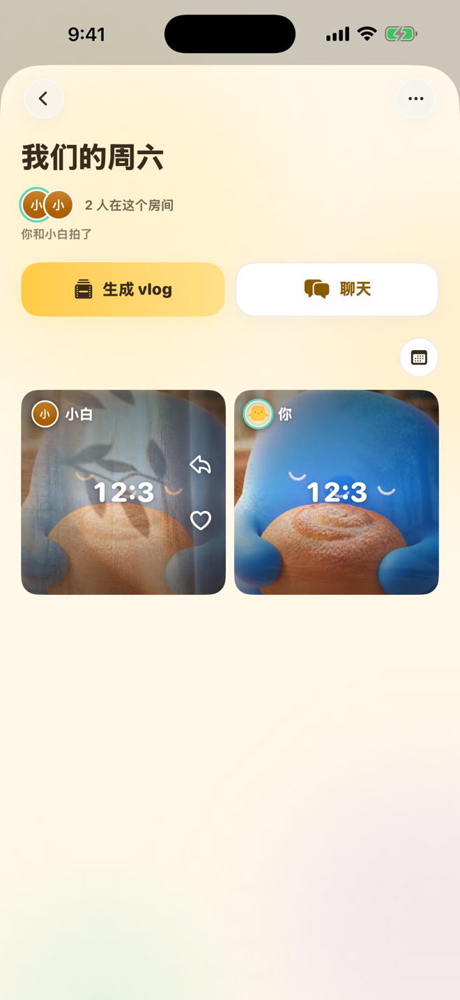
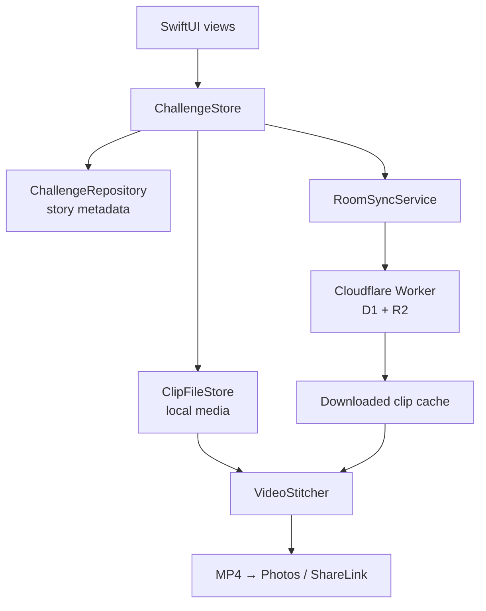

# 1Day（日日）

[English](README.md) · **中文**

**每天拍几秒，攒成你的 vlog。**

1Day 是一个用短视频记录每一天的 iOS App。点一下相机，就拍一段 2 秒的片段；拍的都存进「我的」，按天排好，还有日历。挑几段，就能拼成一支 vlog。你也可以开一个最多 6 人的房间，把片段发进去，点朋友的头像看他这天拍了什么。

[官网](https://1day.liangyue.site) · [中文官网](https://1day.liangyue.site/zh) · [App Store](https://apps.apple.com/cn/app/1-day/id6794565199?uo=4) · [TestFlight](https://testflight.apple.com/join/cRQm6Va2) · [更新日志](https://1day.liangyue.site/updates)

<p align="center">
  
  &nbsp;&nbsp;
  
</p>

截图是模拟器构建里的真实 App 界面，人物和片段都是演示数据，不是真实用户。截图拍于底部标签改名之前，所以底栏写的是「我的 / 朋友」；当前代码里的两个 tab 是**相机**和**房间**。

## 状态

- **仓库 / 开发版本：1.5（build 35）**，来自 [`ios/project.yml`](ios/project.yml)。
- **1.5 是 TestFlight 公测版。** 按[更新日志](https://1day.liangyue.site/updates)，它还没在 App Store 上线。这里记录的最近一个 App Store 版本是 **1.1**（2026 年 8 月 25 日发布，2026 年 9 月 8 日查验），本文不声称有更新的版本。
- 最新的构建通过 [TestFlight](https://testflight.apple.com/join/cRQm6Va2) 发出。

## App 现在能做什么（1.5）

两个 tab：**相机**和**房间**。个人库「我的」从房间页进入。

- **相机。** 点一下拍一段 2 秒的片段，到时间自动停。前后摄像头、变焦，以及画面上带日期的 DV 机效果。支持多摄的 iPhone 可以前后摄像头一起拍。还没归档的片段可以先存成待归档。
- **我的。** 你拍的所有片段按天分组，有日历可以跳到某一天。勾几段，生成 vlog。每天的日期旁边是那天的心情。
- **计划和心情。** 顶部是一周日历。五个表情里选一个今天的心情，写今天的清单，从提醒事项导入（只读），或让 AI 把一句话写成清单。过去的日子可以生成回顾。
- **房间。** 创建房间，把六位邀请码发给朋友，一个房间最多 6 人。每个成员一张片段卡片。点头像连着看这个人这天拍的，日历按钮选看哪天。房间里有聊天、表情回应、评论，朋友还没拍可以拍一拍。每段片段发到哪几个房间由你选；不发，就只有你自己看得到。
- **Vlog。** 选片段、排顺序，生成 vlog。在房间里生成，可以把几个人放进同一个画面。声音可选原声、音乐（内置六首）或混合。调节面板可以改柔和度、亮度和暖色。合成在手机上完成，可以保存到相册或分享 MP4。
- **头像和账号。** 用照片或一个小角色当头像。用 Apple 或 Google 登录（房间需要登录）。退出房间会删除你在里面的片段、回应、评论和成员记录；删除账号会把你的房间和片段从云端删除。
- **通知。** 房间动态的推送由 Worker 经 APNs 发出。
- **语言。** 英文和简体中文。

### 早期版本

到 1.1 为止，App 围绕「选主题、跟着瞬间提示拍」，有一天和七天的故事。1.5 去掉了主题和模板选择：新建的计划和房间只需要一个名字（计划还有一份清单）。那套流程留下的一些类型和素材仍在代码里，好让已有的故事和片段能打开；它们不是现在的主流程。更新日志保留了历史。

## 架构



- **设备上合成。** `VideoStitcher` 构建 AVFoundation 合成（轨道、混音、Core Animation 叠加层），导出 MP4，不需要渲染服务器。
- **后端：Cloudflare Worker。** [`workers/api`](workers/api) 用 D1 存房间、成员、片段、回应、聊天、拍一拍和心情日记，用 R2 存视频和头像，推送走 APNs。服务地址是 `auth.liangyue.site`，每个路由都需要 bearer token。`CloudKitService.swift` 这类文件虽然名字里有 CloudKit，实际调用的是这个 Worker；App 已经离开 CloudKit，`workers/api/scripts/migrate-cloudkit.mjs` 负责搬旧数据。
- **幂等的片段。** 共享片段的 ID 由房间、参与者和槽位推出，重拍会更新同一条记录。房间码是房间的 key，是邀请而不是秘密。
- **AI 清单建议。** 如果你让 AI 写清单，App 会把你那一句话、数量、语言和一个随机安装标识发给 [`workers/suggest-prompts`](workers/suggest-prompts)，由它调用 DeepSeek。它收不到你的视频。

## 技术栈

| 领域 | 实现 |
| --- | --- |
| App | Swift 5.9、SwiftUI、Observation、iOS 17+ |
| 拍摄 | AVFoundation（支持的机型含多摄像头同时拍） |
| 合成 | AVMutableComposition、AVVideoComposition、AVAudioMix、Core Animation |
| 后端 | Cloudflare Worker（`workers/api`）、D1、R2、APNs |
| 登录 | Sign in with Apple、Google Sign-In |
| 持久化 | Codable 元数据，媒体存在磁盘 |
| 网站 | React 19、Vite 6、预渲染双语路由、Vercel |
| AI 清单建议 | Cloudflare Worker（`workers/suggest-prompts`）、DeepSeek |
| 工程生成 | XcodeGen |
| 测试 | XCTest 和 XCUITest |

## 仓库结构

```text
ios/
├── AISetlog/               # App 源码（SwiftUI）
│   ├── App/                # 入口
│   ├── Models/             # 故事、片段、互动（不含展示文案）
│   ├── Presentation/       # 纯展示逻辑（不 import SwiftUI，不读 `.now`）
│   ├── Resources/          # 本地化、音乐、主题
│   ├── Services/           # 云端、拍摄与合成、持久化、通知
│   └── Views/              # 计划/我的、房间、录制、成片、片段库、心情、头像、设置
├── AISetlogTests/          # 单元测试
├── AISetlogUITests/        # UI 测试
└── project.yml             # XcodeGen 工程定义
landing-page/               # React/Vite 产品官网
workers/api/                # 后端：登录、房间、片段、聊天、推送（D1 + R2）
workers/suggest-prompts/    # AI 清单建议服务
android-app/                # 旧流程的 Flutter 原型（见下）
docs/                       # 产品笔记、测试协议、素材
```

贡献规则（分层、CI、提交）见 [AGENTS.md](AGENTS.md)。

## 运行 iOS App

需要：macOS、带 iOS 17 SDK 或更新版本的 Xcode，以及 [XcodeGen](https://github.com/yonaskolb/XcodeGen)。

```bash
cd ios
xcodegen generate --spec project.yml
open AISetlog.xcodeproj
```

用 `AISetlog` scheme 在 iPhone 或模拟器上运行。增、删、改名源文件之后要重新跑 `xcodegen generate`；`.xcodeproj` 不进仓库。相机表现和成片上的叠加层应在真机上确认，因为模拟器会编译掉其中一部分。

房间需要 Apple Developer 团队（Sign in with Apple 和推送权限）以及可访问的后端。App 连的是 `auth.liangyue.site` 上的 Worker；想自己跑一套，请部署 [`workers/api`](workers/api)。

## 测试

```bash
cd ios
xcodegen generate --spec project.yml
xcodebuild test \
  -project AISetlog.xcodeproj \
  -scheme AISetlog \
  -destination 'platform=iOS Simulator,name=<已安装的 iPhone 模拟器>' \
  CODE_SIGNING_ALLOWED=NO
```

用你装好的任意 iPhone 模拟器（`xcrun simctl list devices available`）。CI（[`.github/workflows/ios-tests.yml`](.github/workflows/ios-tests.yml)）跑分层检查，以及单元、UI 和共享房间三条 lane，并跳过四个无法在未签名环境运行、名字里带 CloudKit 的套件。

两个 Worker 各有自己的测试：

```bash
cd workers/api && npm test
cd workers/suggest-prompts && npm test
```

## 运行官网

源码在 [`landing-page/`](landing-page)，线上地址是 [1day.liangyue.site](https://1day.liangyue.site)。路由：`/` 和 `/zh`，`/updates` 和 `/zh/updates`（更新日志），`/privacy` 和 `/zh/privacy`。

```bash
cd landing-page
npm install
npm run dev
```

`npm run build` 生成客户端包并预渲染各路由；`npm run preview` 本地预览。截图和插画示例影片在 `landing-page/public/assets`。那里有些图比当前 App 旧（例如 `app-theme-*` 和 `app-film-*` 已不再是名字所说的界面）。

## Android

[`android-app/`](android-app) 是一个 Flutter 项目（`1.0.0+1`，包名 `com.cassie.one_day`），沿用的是早期的一天/七天模板流程。它是离线原型，没有跟进 1.5，官网没有链接，release APK 用的是 debug 签名。请当作未发布。

## 内测

测试协议和不含隐私的结果模板在 [docs/BETA_TESTING.md](docs/BETA_TESTING.md)。仓库不声称任何没有实测过的使用率或完成率数据。

## 许可证

[MIT](LICENSE)
