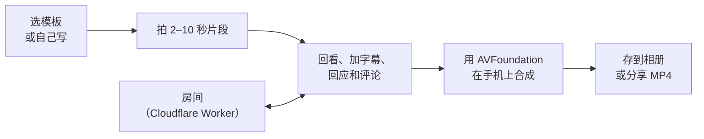
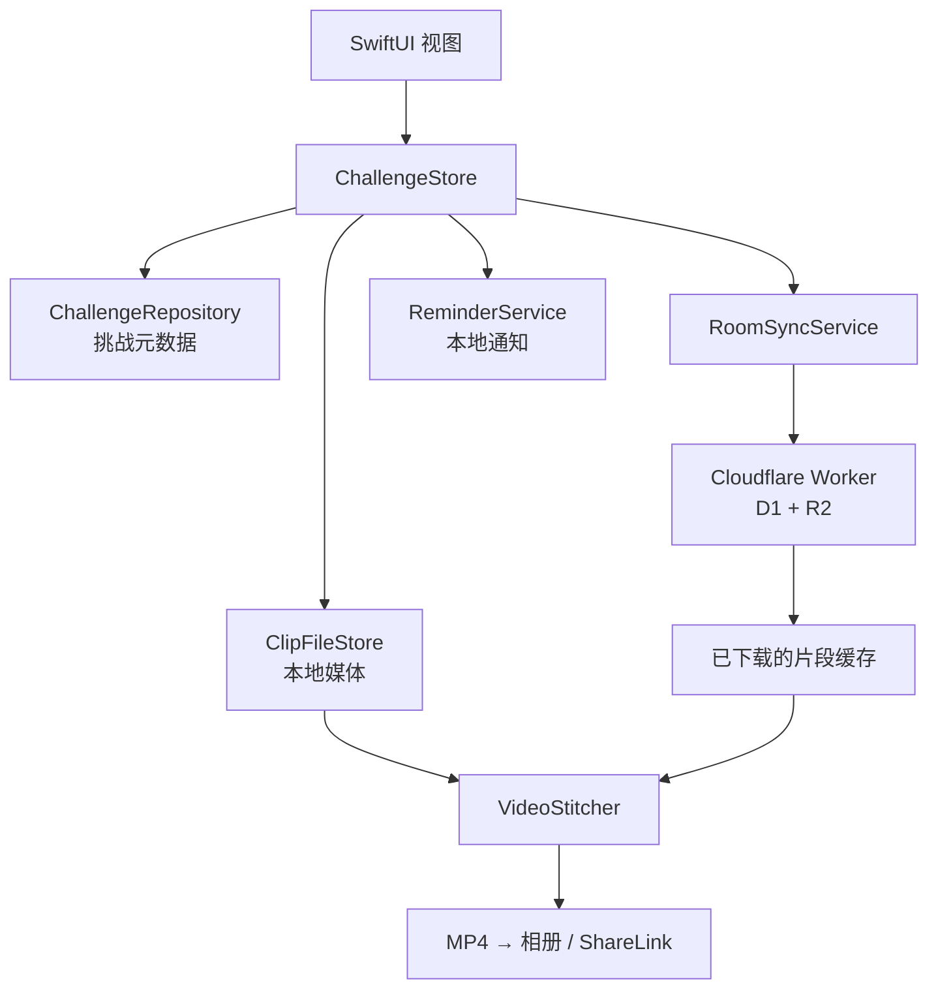

# 1Day（日日）

[English](README.md) · **中文**

**给今天定一个主题。用自己的方式过，一个人或和朋友一起，最后做成一支 vlog。**

1Day 从一个问题开始：**今天想怎么过？** 选一个主题，跟着几条瞬间提示，一个人或和朋友一起把这一天拍下来。
做好的 vlog 就是留念。原生 iOS App 支持一天和七天的故事，成片完全在手机上合成。

**主题 → 瞬间 → 一起 → 成片**

[官网](https://1day.liangyue.site) · [中文官网](https://1day.liangyue.site/zh) · [App Store](https://apps.apple.com/us/app/1-day/id6794565199) · [TestFlight](https://testflight.apple.com/join/cRQm6Va2) · [更新日志](https://1day.liangyue.site/updates)

<p align="center">
  
  &nbsp;&nbsp;
  
  &nbsp;&nbsp;
  
</p>

截图是在独立的 iOS 模拟器构建里截的真实 App 界面。Blue 的插画故事和共享成员都是演示数据，不是用户素材，也不能证明有真实的多人使用。

## 1.5 版：房间和自己的一天

当前开发版（1.5，build 35）有两个 tab：**相机**和**房间**。自己的时间线从房间页进入。

- **房间。** 每个成员一张片段卡片。横拍房间上下排 16:9 卡片，竖拍房间按人数排格子。点头像只看这个人的片段，全屏连播。右上角日历按钮选看哪天。
- **聊天和回应。** 房间里有聊天、表情回应、评论和拍一拍。推送通知显示聊天原文，并跟随 App 语言。
- **计划和心情。** 首页的周日历显示每天的计划和心情。可以写计划、从提醒事项导入，或让 AI 把一句话写成待办清单。过去的日子可以生成回顾。
- **成片。** 可以拖动片段，按自己的顺序排房间成片。「温柔滤镜」可调柔和度、亮度和暖度，用于回看和导出。横竖混拍的片段放在模糊底图上，不再被裁掉。
- **头像。** 可以选照片或小人，贴纸会按脸裁切。
- **账号。** 支持 Apple 和 Google 登录。退出房间会删掉你在房间里的片段、回应、评论和成员记录。删除账号会从云端删掉你的房间和片段。

1.5 **尚未上架**。2026 年 9 月 8 日核实的 App Store 最新版本是 **1.1**，发布于 2026 年 8 月 25 日。仓库里的功能可能比商店版本新，最新构建通过 [TestFlight](https://testflight.apple.com/join/cRQm6Va2) 发放。

## 想法

多数日子是靠几个小瞬间被记住的，而不是一段长录像。1Day 给每个瞬间一条提示，让每段片段保持很短，最后再统一剪辑。结果是一支属于自己的影片，不需要相册里堆满素材，也不需要花一晚上用剪辑软件。

## 产品亮点

- **一天或七天。** 今天拍几个瞬间，或者一周内每天回来拍一段。
- **有引导，也可以自己来。** 从中英双语主题开始，自己写提示，或不按提示顺序、按时间拍。
- **刻意很短。** 片段可选 2、5、10 秒，并可把挑战锁定为竖拍或横拍。
- **和朋友一起。** 创建房间，用六位邀请码邀请朋友，把大家的片段收进同一个共享故事。
- **不只是片段列表。** 朋友可以留表情回应和评论，这些互动可以出现在最终成片里。
- **完整的相机流程。** 切换前后摄像头，回看一段，加叠加文字，或重拍同一个瞬间。
- **自动剪辑。** AVFoundation 把片段、音频、交叉淡化、标题卡、提示字幕、名字、日期、回应和评论合成在一起。
- **成片由你决定。** 预览结果，调整标题卡、字幕和转场长度，然后存到相册或分享 MP4。
- **本地优先。** 单人挑战不需要账号和后端。共享房间需要登录账号。
- **房间提醒。** 推送通知（APNs，由 Worker 发送）告知房间里的新片段、聊天和回应。
- **英文和简体中文。** 产品文案、提示、模板和权限说明跟随所选的 App 语言。

## 工作流程



## 工程实现

### 手机上的视频合成

`VideoStitcher` 加载并统一每段素材，保留摄像头的方向变换，建立交替的合成轨道，用交叉淡化混音，并通过 `AVVideoCompositionCoreAnimationTool` 加 Core Animation 叠加层。导出的 MP4 可直接分享，个人素材不会发到渲染服务器。

代价是：设备上的媒体行为比集中式渲染更难预测。实现里明确处理了方向、轨道生命周期、音频范围、空输入和模拟器限制。

### 本地优先的服务边界

`ChallengeStore` 持有可观察的 App 状态，存储和 I/O 交给别的组件：



这样核心流程离线也能用，存储、协作、通知、拍摄和合成各自放在职责单一的组件后面。

### 后端：Cloudflare Worker

房间、成员、片段、回应、聊天、拍一拍和心情日记存在 D1；视频和头像存在 R2；房间提醒直接发给 APNs。App 已从 CloudKit 迁到这个 Worker（`workers/api`，地址 `auth.liangyue.site`）。每个接口都需要 bearer token，调用者始终是自己所写内容的作者。`workers/api/scripts/migrate-cloudkit.mjs` 负责把旧的 CloudKit 数据迁过来。接口和部署步骤见 [Worker](workers/api)。

### 幂等的协作

共享片段的 ID 由 `房间 + 成员 + 槽位` 推导。重拍会更新同一条记录，不会产生重复。房间码就是房间的键，所以加入房间是直接读取，不是查询。房间码只是方便邀请，不是安全密钥。

### 向后兼容的状态

已保存的挑战使用稳定的提示 key 和容忍版本差异的解码。旧的中英文提示字符串、旧版挑战默认值和最初的单挑战存储格式，都会被迁移或解析，不会丢掉用户的片段。

### 可选的提示建议

核心的单人拍摄流程留在手机上。用户请求建议时，App 会把他们写的那句话、提示条数、语言和一个随机的安装标识发给另一个 Cloudflare Worker。该 Worker 用 DeepSeek 生成提示建议，不会收到用户的视频片段。用户也可以不调用这个服务，自己写提示。配置见 [Worker](workers/suggest-prompts)。

## 技术栈

| 方面 | 实现 |
| --- | --- |
| App | Swift 5.9、SwiftUI、Observation、iOS 17+ |
| 拍摄 | AVFoundation（`AVCaptureSession`、`AVCaptureMovieFileOutput`） |
| 合成 | AVMutableComposition、AVVideoComposition、AVAudioMix、Core Animation |
| 协作 | Cloudflare Worker（`workers/api`）、D1、R2、APNs、Sign in with Apple、Google 登录、深度链接 |
| 持久化 | UserDefaults 里的 Codable 元数据，媒体存磁盘 |
| 通知 | UserNotifications |
| 网站 | React 19、Vite 6、预渲染的双语路由、Vercel |
| 可选的提示建议 | Cloudflare Worker（`workers/suggest-prompts`）、DeepSeek |
| 工程生成 | XcodeGen |
| 测试 | XCTest，带真实 MP4 导出夹具 |

## 仓库结构

```text
ios/
├── AISetlog/
│   ├── App/               # App 入口和生命周期
│   ├── Models/            # 挑战、卡片、片段、模板、互动
│   ├── Presentation/      # 本地化的展示逻辑
│   ├── Resources/         # 主题、本地化和媒体夹具
│   ├── Services/
│   │   ├── Cloud/         # Worker API 客户端、认证和房间同步
│   │   ├── Media/         # 相机拍摄和 AVFoundation 合成器
│   │   └── Persistence/   # 元数据仓库和片段文件存储
│   └── Views/             # 首页、计划、心情、拍摄、成片、房间、头像、设置
├── AISetlogTests/          # 状态、本地化、迁移和导出测试
└── project.yml             # XcodeGen 工程定义
landing-page/               # React/Vite 产品官网
workers/api/                # 后端：认证、房间、片段、聊天、推送（D1 + R2）
workers/suggest-prompts/    # 可选的拍摄提示服务
docs/                       # 产品文档、内测流程和素材
```

## 运行 iOS App

### 环境要求

- 装有 Xcode 和 iOS 17 或更新 SDK 的 macOS
- [XcodeGen](https://github.com/yonaskolb/XcodeGen)

```bash
cd ios
xcodegen generate --spec project.yml
open AISetlog.xcodeproj
```

选 `AISetlog` scheme，在 iPhone 或 iOS 模拟器上运行。模拟器可以走通产品流程和导出夹具；相机行为和 Core Animation 叠加层需要在真机上验证。

共享房间还需要一个 Apple Developer 团队（Sign in with Apple 和推送权限）和一个可访问的后端。App 连接的是 `auth.liangyue.site` 上的 Worker；想跑自己的后端，请部署 [`workers/api`](workers/api)。

## 运行官网

源码：[`landing-page/`](landing-page)。线上站点是 [1day.liangyue.site](https://1day.liangyue.site)。

路由：`/` 和 `/en` 是产品站，`/updates` 和 `/en/updates` 是 App 更新日志，`/privacy` 和 `/en/privacy` 是隐私说明。

```bash
cd landing-page
npm install
npm run dev
```

生产构建和本地预览：

```bash
npm run build
npm run preview
```

构建会生成客户端包并预渲染全部六个路由。App 截图和插画演示视频放在 `landing-page/public/assets`。演示视频有可选的中英文字幕；首屏以下的图片懒加载，视频等到播放时才加载。

## 测试

```bash
cd ios
xcodegen generate --spec project.yml
xcodebuild test \
  -project AISetlog.xcodeproj \
  -scheme AISetlog \
  -destination 'platform=iOS Simulator,name=iPhone 17' \
  CODE_SIGNING_ALLOWED=NO
```

测试覆盖挑战和卡片状态、本地化提示解析、旧数据解码、删除账号、房间同步和聊天、头像、心情，以及用真实媒体夹具导出可播放的 AVFoundation MP4。

## 项目状态

1Day 已在 [App Store](https://apps.apple.com/cn/app/1-day/id6794565199?uo=4) 上架。测试流程和保护隐私的结果模板仍在 [docs/BETA_TESTING.md](docs/BETA_TESTING.md)；仓库不会声称没有实际测量过的使用量或完成率数据。

## 许可证

[MIT](LICENSE)
