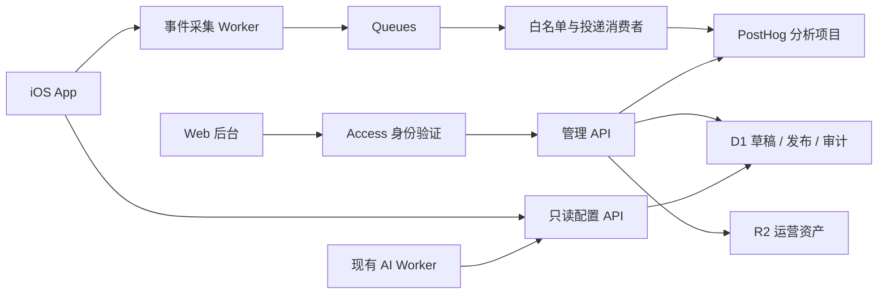

# 1day Admin v1 · 产品分析与运营后台

版本：0.1，可实施设计稿。日期：2026-09-22。负责人：Cassie。状态：方案与本地交互原型；线上服务和 iOS 接入尚未实施。

## 1. 产品目标

让运营者完成「观察用户创作 → 定位流失或故障 → 调整主题和配置 → 发布 → 观察变化」的工作。

核心价值指标：每周生成并实际观看成片的去重分析主体数。辅助指标：首次有效拍摄、成熟故事成片率、相册保存率、再次创作率。匿名主体按安装统计，界面写“安装”，不能声称是跨设备唯一用户。

用户：首位管理员 Cassie。v1 支持 viewer、editor、owner 三个固定角色，不做自定义权限平台。viewer 只看聚合数据；editor 编辑内容草稿；owner 发布、回滚、管理成员和分析删除请求。

### 范围

| 属于 v1 | 后续扩展，不作为 v1 上线依赖 |
|---|---|
| 总览、创作漏斗、留存、多人与 AI 分析 | 任意拖拽报表和 SQL 编辑器 |
| 中英文主题库、推荐位、提示横幅 | 大规模营销自动化、用户分群推送 |
| 配置版本、兼容规则、发布、回滚、定时发布 | 通用实验平台、复杂个性化推荐 |
| 运行监控、采集健康、后台告警、审计 | 自动修复线上数据、远程执行代码 |
| 分析数据关闭与删除路径 | 私人视频、聊天或 AI 原文的管理员浏览 |

App 本地创建、拍摄和合成不依赖运营后台可用性。远程配置不得更改已创建故事的标题、提示或拍摄要求。

## 2. 当前项目事实与设计约束

依据本次实际读取的 README、ios/project.yml、PromptSuggestionMetrics.swift、PromptSuggestionService.swift、FilmView.swift：

- 原生 SwiftUI iOS App，支持一天／七天、单人／多人、端上合成；多人协作使用 CloudKit。
- AI 建议经过现有 Cloudflare Worker。建议服务支持返回标题和提示；早期 README 中的仅提示描述不能当作完整接口。
- PromptSuggestionMetrics 已在本机记录 generated、adopted、promptsOffered、promptsEdited；不上传内容。这些累计计数不能直接回灌成历史事件。
- FilmView 的渲染完成还区分 superseded、sessionEnded、failed、film；只以真正可供当前会话使用的成片结果计入成功。
- 本次工作树存在其他任务修改，尤其 CloudKitService.swift、Localization.swift 和官网。该方案不覆盖或回滚这些修改。
- GitNexus 索引与 HEAD 相同，但有两个源文件内容漂移；图用于定位，引用事实以当前源码为准。本次没有修改 App 核心符号。

## 3. 信息架构与视觉设计

```text
1day / 运营工作台
├─ 总览                今天发生了什么，最需要看什么
├─ 创作分析            创作漏斗 / 留存 / 多人 / AI 建议
├─ 主题管理            列表 / 编辑草稿 / 内容预览
├─ 运营配置            推荐主题 / 横幅 / 功能开关
├─ 运行监控            故障 / 告警 / 采集健康
└─ 发布记录            版本详情 / 差异 / 回滚 / 操作审计
```

桌面布局：220px 侧栏，主内容最大宽度 1440px；标题、筛选栏、摘要、主图表／表格由上至下。1280px 下保持表格可读；小屏切为可横向滚动的导航，表格在容器内滚动。

设计变量：背景 #F5F7FA，表面 #FFFFFF，正文 #202833，边框 #E5E9EF，主动作珊瑚色 #ED735D，成功色 #218478。正文使用系统无衬线与 PingFang SC；表格数字使用等宽数字。危险状态用文字和图标辅助，不能只靠颜色。

后台沿用 1day 温和的品牌气质，但以读数和操作为主。不使用营销首页式大标题，不把每个数字放进强装饰卡片。

### 统一状态

| 状态 | 界面行为 |
|---|---|
| 初次加载 | 保留标题、筛选器和结构，占位不显示虚构数字 |
| 刷新 | 保留旧结果，显示刷新中和旧数据截止时间 |
| 空数据 | 明确“尚未收到数据”；无法计算的比率显示 —，不是 0% |
| 筛选后无数据 | 保留筛选器，提供清除筛选 |
| 查询失败 | 保留旧结果并标“上次结果”，重试按钮；不能显示成 0 |
| 数据延迟 | 显示事件截止时间、水位与延迟提示 |
| 编辑失败 | 保留输入，错误定位到字段或提交区域 |
| 并发冲突 | 展示本地草稿与远端版本差异，不自动覆盖 |

生产环境顶部明确标识“正式环境”；原型持续显示“本地原型 · 演示数据 · 不影响线上 App”。演示、测试和生产分项目／数据库隔离，不能只靠前端筛选防混入。

## 4. 页面与操作规格

### 4.1 总览

默认过去 7 个完整自然日，时区 Asia/Shanghai；可选 28 天和自定义范围，右侧展示“数据截至”和最后查询时间。图表时区仅决定展示分桶；漏斗观察窗口以连续小时计算。

展示：活跃安装、首次有效拍摄安装、观看成片安装、成熟故事成片率、相册保存成功率、再次创作率。每项显示样本量；环比对比前一等长区间，分母为 0 时不显示无限增长。

下方展示每日创作趋势、漏斗摘要、最多 3 条需要处理的问题、主题表现。问题只由阈值或确定规则产生，不生成无证据的“增长原因”。从卡片进入分析页时保留环境、时区、日期和筛选条件。

### 4.2 创作分析

两个漏斗分开：

1. 激活漏斗：first_open → story_created → first clip_saved → film_play_started，按分析主体关联，24 小时首次拍摄、7 天首次成片分别观察。
2. 故事漏斗：story_created → clip_saved → film_render_finished(success) → film_play_started → film_save_result(success)，按 actor_id + story_id 关联，要求事件顺序成立。分享是旁支，不放在必须步骤里。

故事漏斗以创建日在选定区间内的故事为 cohort，后续事件可发生在区间结束后，但必须在观察窗内；不能用各步骤在同一天发生的总数直接相除。一天故事观察 48 小时，七天故事观察 9×24 小时。尚未成熟的 cohort 展示暂定进度，不混入最终成片率。

留存页展示“再拍摄”而非只打开：首次 clip_saved 后不同日期再次 clip_saved；D7 精确日留存与 7 天内再次创作率分列。七天任务内的继续拍摄和创建第二个故事分列。分群比较只表述相关性，不据此声称多人功能带来因果提升。

多人页按 opaque room_analytics_id 跨成员聚合，显示至少两人加入、至少两人贡献、合拍生成。该ID由房主创建房间时随机生成并作为独立可选字段随房间同步，不能由邀请码或CloudKit记录名直接派生。旧房间没有该字段时不计算跨成员贡献率；未参与可选分析的成员不进入统计，页面说明“参与分析的成员样本”。邀请面板打开不是发送成功；加入来源无法可靠关联时显示未知，不伪造成邀请转化。

AI 页以 request_id 连接请求、结果、采用和故事创建。采用定义为成功返回的某组建议最终被保存为故事；编辑率仅上传数量和位置计数，不上传原文。v1 保持已有本地改写口径并标注算法版本，后续更改算法须新版本，不能直接拼接趋势。

### 4.3 主题管理

列表字段：标题、类型、分类、提示数、草稿状态、当前线上状态、最近编辑时间；按标题、类型、状态搜索。线上状态来自当前发布快照，不从草稿推断。

编辑字段：稳定 theme_id、zh/en 标题、zh/en 简介、封面资产引用、类型 one_day/seven_day、提示列表（稳定 prompt_id + zh/en 文本）、标签、可用状态、min_app_version、排序。ID 由服务端生成，不允许复用已归档主题 ID。

v1 运营内容限制：标题 1–40 字符，简介不超过 160 字符，提示 1–100 字符；一天主题 1–12 个提示，七天主题 7 个提示；双语提示逐项对应。限制是新运营接口的规则，不能用它拒绝或迁移用户旧故事。完整支持英文／中文，缺失任一语言阻止发布。

封面只允许经过资产服务校验的 JPEG/PNG/WebP，最大 5 MiB，长边不超过 2048px；不接受任意外部 URL 或 SVG。上传后清除 EXIF。主题可没有远程封面，App 显示内置占位。

动作：新增 → 编辑 → 保存草稿 → 预览。草稿可暂存缺失字段，发布必须通过完整校验。下架通过新版本去除可用状态实现；历史引用保留，不硬删除发布过的主题。运营者可删除从未发布的草稿。

用户创建故事时复制所选主题版本与提示内容；远端模板下架不删除已开始的故事。主题封面资产不因下架立即删除，至少保留仍被保留发布版本引用的资产。

### 4.4 运营配置

一份环境级草稿包含：推荐主题顺序（0–6 个不重复且可用的主题 ID）、双语横幅（可关闭、可设起止时间、只接受受限 App 路由）、AI 建议可用开关。第一版没有营销推送和自动弹窗规则。

页面显示草稿基于哪个版本、未发布变更数量和线上版本；保存只保存草稿。发布前展示影响摘要及差异；“发布版本”是一次明确操作，不再叠加同义确认。

AI 开关只禁止新 AI 请求；已经拍摄的数据和手写提示不受影响。服务端也校验此开关，默认在配置读取失败时保持最近已知安全策略，不能靠 App 入口隐藏控制服务费用。

支持定时发布：schedule 保存已校验且冻结的快照及 base_revision；到期时重新校验兼容性与引用关系，版本已有变化则进入 conflict，不悄悄覆盖新版本。取消、失败和实际执行时间进入审计。

### 4.5 运行监控

四条链路：录制／本地保存、合成／相册保存、CloudKit 加入／上传／同步、AI 请求。按错误码、App 版本、系统版本聚合；只能查看白名单上下文，不展示异常原文和本地路径。

权限拒绝属于用户选择，单独统计，不计系统故障；取消、superseded、session_ended 单列。缺失结果是 unknown，不能臆测成功或失败。崩溃数据另接 Apple/Xcode 或专用 crash 服务，普通事件流不声称具备完整崩溃监测。

初始告警规则（可配置产品默认值，并非供应商保证）：

| 规则 | 触发条件 | 恢复 |
|---|---|---|
| AI 错误异常 | 15 分钟 ≥20 次已结束请求，失败率 >10%，连续两窗 | 连续两窗 ≤5% |
| 合成错误异常 | 60 分钟 ≥20 次已结束有效尝试，失败率 >5%，连续两窗 | 连续两窗 ≤2% |
| 消费积压 | 最老未处理事件等待 >10 分钟，连续两次检查 | <2 分钟持续两次 |
| 采集异常 | 定时合成探针连续 3 次不通；探针不进业务统计 | 连续 2 次成功 |

低样本不触发比例告警，但显示样本数和“样本不足”。安静时段没有用户事件不是故障。客户端离线导致的迟到事件用于历史修正，不追溯触发实时告警。告警以规则+环境+维度去重，30 分钟冷却；确认告警只记操作，不等于故障已恢复。

后台告警为 v1 必做，邮件／飞书等外部通知待接收人、渠道凭据确认后接入。未经单独授权不发送测试消息。

### 4.6 发布记录与审计

每次发布显示 revision、操作者、时间、来源草稿、差异、payload_hash、状态。查看历史版本只读。回滚复制目标版本为新版本，例如 v8 回滚 v5 内容生成 v9，永远不降低版本号。

回滚时仍校验当前客户端兼容性、引用资产是否可用；不允许将已撤销的危险路由重新发布。回滚只改变已发布快照，保留当前未发布草稿及其base_release_revision；草稿基线因此落后时，下次发布先展示差异并显式确认新的基线，不能静默覆盖或抹掉草稿。回滚不会恢复已经注销的用户、删除分析数据或修改用户故事。

审计记录：登录后的高风险操作、草稿变更、发布、回滚、排期、角色变更、分析删除。只记录必要管理员身份、对象 ID、前后版本及摘要，不记密钥和会话令牌。

## 5. 指标字典

统一 event schema v1，metric_version=1，UTC 存储，运营时区分桶；后端返回 numerator、denominator、value、sample_size、maturity、watermark、metric_version。value 缺失为 null。

| 指标 | 分子／定义 | 分母／去重 | 窗口与注意事项 |
|---|---|---|---|
| 活跃安装 | app_opened 主体数 | distinct actor_id | 区间内；并非活跃真实人数 |
| 首次有效拍摄 | 自启用分析后首次 clip_saved 在区间内的主体数 | distinct actor_id | 首次接入埋点的存量安装不冒充新安装 |
| 新安装首次拍摄转化 | first_open 后 24h 内 clip_saved 的主体 | 满足 24h 观察的 first_open 主体 | 首次启动 cohort；需要 install_kind=new |
| 观看成片安装 | success 合成后实际开始播放的主体 | distinct actor_id | 相同故事重复渲染不会增加安装数 |
| 成熟故事成片率 | 观察窗内至少一次有效合成成功的故事 | 已成熟创建 cohort 的故事 | distinct actor_id+story_id；一天48h／七天216h |
| 相册保存成功率 | film_save_result success 尝试 | success+failure 的保存尝试 | 按 operation_id 去重；权限拒绝另列 |
| 成片保存覆盖率 | 成片后成功保存的故事 | 已生成成片的同 cohort 故事 | 不与保存技术成功率混称 |
| 7天再次创作 | 首次片段后不同当地日期且168h内再次有效保存 | 已观察168h的首次片段主体 | 使用首次片段的冻结时区；默认排除替换同一 slot |
| D7精确日留存 | 首次片段日期+7日有有效拍摄 | 已完整观察第7日的主体 | 与“7天内任意一天”不同 |
| 第二个故事率 | 28天内创建不同 story_id 的主体 | 已观察28天且创建首个故事的主体 | 单列只创建但未拍摄情况 |
| 多人贡献率 | ≥2个不同 actor_id 成功贡献的房间 | 同 cohort 中≥2成员加入的成熟房间 | 需稳定非邀请码关联 ID |
| AI采用率 | 成功返回的建议组中至少一次被故事采用的组数 | 已观察24h的成功建议组数 | request_id 去重；不以按钮点击计采用 |
| AI提示改写率 | 采用时 edited_count 总和 | 采用时 offered_count 总和 | 记录 calculation_version；不能传原文 |
| 合成成功率 | result=success 的操作数 | success+failure 的操作数 | 取消／替代／会话结束／unknown另列 |

筛选规则：故事属性冻结在创建事件上；后续从创建事实关联，不随最后一次事件变化。系统版本用于技术错误分析时取操作发生时的值。全球日期范围、时区和环境在 URL 中持久化；不适用的筛选明确隐藏或禁用并说明，不静默忽略。

首次事件不能每次仅对90天原始数据取MIN。分析端维护去重主体的first_seen/first_clip/first_story事实，保留13个月并纳入删除链路；身份事实过期后返回的安装标记existing_unknown，不重新当成新安装。尚未成熟、观察数据缺失和已超出保留期的cohort各自标注，不显示成留存为零。

## 6. 事件协议

### 公共信封

```json
{
  "schema_version": 1,
  "event_id": "b1f6b988-97d4-4d66-b03b-9752100b1234",
  "name": "clip_saved",
  "occurred_at": "2026-09-22T08:12:30.123Z",
  "actor_id": "a693a655-b315-47ae-9b60-4976bce71234",
  "session_id": "fe1bbccf-c862-4f2b-a98a-477c87b91234",
  "sequence": 12,
  "app_version": "1.4",
  "build_number": "24",
  "os_version": "26.0",
  "locale": "zh-Hans",
  "timezone_offset_minutes": 480,
  "properties": {
    "story_id": "9eefb9b0-eac1-4b21-9ce2-6fcd9e421234",
    "operation_id": "0d754913-f58b-480b-9d6c-f0bb8baa1234",
    "slot_index": 2,
    "is_retake": false,
    "duration_ms": 5000
  }
}
```

received_at、trusted_environment、source、ingestion_status 由服务端补充。客户端发送的 environment 不决定数据落在哪个生产项目；不同发行渠道使用不同采集端点和绑定。公开采集端点仍可能被伪造，不能把包内常量当作安全凭据。

安装分析 ID 使用独立随机 UUID，不复用 Sign in with Apple 的用户 ID、IDFA、iCloud record ID 或现有仅用于限流的 DeviceIdentity。v1 不跨设备合并安装；登录人数另行设计，不误导为已去重用户。

### 事件字典

| 事件 | 触发点 | 专有属性 |
|---|---|---|
| first_open | 新安装首次可用启动，仅一次 | install_kind=new/existing_unknown；首次接入旧用户为 existing_unknown |
| app_opened | 前台新会话，前次后台≥30分钟 | entry=normal/deep_link/notification |
| story_creation_started | 进入创建流程 | flow_id、entry=home/theme/invite |
| story_created | 创建持久化成功 | story_id、flow_id、type、mode、source、theme_id/version、planned_moments、config_revision |
| recording_started | 相机实际开始录制 | story_id可空（自由拍摄）、operation_id、slot_index |
| recording_finished | 原始录制结束 | operation_id、result、duration_ms、error_code可选 |
| clip_saved | 确认保留且本地文件／元数据写入成功 | story_id、operation_id、slot_index、is_retake、duration_ms |
| invite_share_opened | 系统邀请分享面板打开 | room_analytics_id、story_id |
| room_join_result | 加入完成或失败 | operation_id、room_analytics_id成功时必填、result、error_code |
| room_clip_sync_result | 片段云端提交结果 | operation_id、room_analytics_id、result、error_code |
| film_render_started | 合成任务真正启动 | story_id、operation_id、clip_count、layout |
| film_render_finished | 当前合成结果已判定 | story_id、operation_id、result、duration_ms、error_code |
| film_play_started | 可播放成片开始播放 | story_id、render_operation_id |
| film_save_result | 相册保存回调完成 | story_id、operation_id、render_operation_id、result、error_code |
| film_share_opened | 系统成片分享面板打开 | story_id、render_operation_id |
| ai_suggestion_requested | 请求已发出 | request_id、requested_count |
| ai_suggestion_result | 请求与解码完成 | request_id、result、duration_ms、returned_count、error_code |
| ai_suggestion_adopted | 建立故事时保存生成建议 | request_id、story_id、offered_count、edited_count、calculation_version |
| config_applied | 客户端首次应用不同配置版本 | revision、source=network/cache/bundled |

operation_id 每次尝试生成；同一次重传保持 event_id 与 operation_id。故事重拍是新操作，但同一 story+slot。错误使用枚举如 network_unavailable、permission_denied、disk_full、upstream_timeout、malformed_response、unknown，禁止上传 localizedDescription。

result 通用枚举为 success/failure/cancelled；合成可另含 superseded/session_ended，permission_denied 可在保存结果中单列。超时没有收到结果时由查询计算 unknown，不伪造客户端 failure。

同一操作结果只能有一个逻辑终态；消费端去重键除 event_id 外，对终态约束 name+actor_id+operation_id。如果冲突，隔离并记采集告警，不能 last-write-wins 改历史事实。跨来源的 AI 服务器结果使用 source 区分，不与客户端结果重复相加。

### 批量与离线

客户端单批≤50事件且≤64KiB，单事件≤4KiB；磁盘队列≤5MiB或5000事件，TTL 7天，超限丢最旧并累计非内容型 dropped_count。每30秒或达20条尝试发送；进入后台只尽力刷新，不保证后台执行。指数退避1秒至5分钟加抖动，遵守 Retry-After。

服务端202只表示已可靠入队，非已可查询。部分无效事件返回逐条 accepted_event_ids/rejected，不让一条坏数据永久阻塞整批。400/413逐条定位或拆批；429/5xx重试；Schema非法是不可重试。因队列故障未可靠接收时返回503。

事件可乱序；用 occurred_at、sequence及稳定操作ID重建。未来偏差>5分钟或早于7天的事件隔离为时间异常，不污染实时指标。所有时间判断以服务端 received_at 为比较基准，时区只参与界面分桶。

随附 `analytics-event-v1.schema.json` 是可执行的结构白名单；`analytics-event-v1.examples.json` 是合成样例，不能发到正式采集端。Schema不能单独验证edited_count≤offered_count、事件字节大小、时间偏差、逻辑终态唯一性和身份归属，这些是服务端独立校验。slot_index统一从0开始，展示给用户时加1。

## 7. 技术架构决定

生产目标：React + TypeScript + Vite 后台；独立 Cloudflare Worker 管理API；D1存运营元数据；R2存运营封面；Queues承接事件；PostHog作为分析引擎；Cloudflare Access保护后台。现有 CloudKit 继续承担多人业务，不迁移用户视频。



分析查询通过服务端固定 query_id 和白名单参数执行，浏览器不拿 PostHog personal API key、不提交任意 HogQL。查询缓存按 environment+metric_version+filters+watermark 分键，后台默认按需刷新，不每秒轮询。输出渲染时使用文本节点，禁止信任主题文案的 HTML。

Queues 是至少一次投递，投递消费者必须允许重复。使用稳定 event_id 作为下游幂等标识，业务指标仍按逻辑键 distinct；下游投递超时后重试，不能先标记已投递再发送。重试耗尽进入死信队列并告警，人工重放保留原event_id；采集与死信数据的总保留目标不超过7天。正式上线前用“下游已接收但确认丢失”故障注入确认实际去重行为。[Cloudflare delivery guarantees](https://developers.cloudflare.com/queues/reference/delivery-guarantees/)

D1批处理可以为多语句提供事务回滚，但“更新0行”不等同SQL失败。发布使用事务内显式版本断言（失败必须导致约束失败并回滚）+当前revision条件更新；不能只做一次 UPDATE WHERE 后假设其他语句也回滚。[D1 batch说明](https://developers.cloudflare.com/d1/worker-api/d1-database/)

后台 Worker 必须验证 Access JWT 的签名、issuer、audience、expiry并做角色授权；不能仅相信请求带有邮箱头。源站不能有绕过验证的 workers.dev 公共写入口。[Access JWT验证](https://developers.cloudflare.com/cloudflare-one/access-controls/applications/http-apps/authorization-cookie/validating-json/)

PostHog查询API用于固定的漏斗／留存聚合，后端适配层隔离供应商响应结构。[PostHog queries API](https://posthog.com/docs/api/queries)

### 运行目标与费用控制

这些是待验证的验收目标，不是当前已达到的性能：正常网络下事件95%在5分钟内可查询；缓存配置读取P95<500ms；已缓存看板P95<1s；离线App启动不得等待配置请求。配置payload≤128KiB，封面独立加载。

费用先按事件量估算：月事件≈DAU×每安装每日事件数×30。例：1000×30×30=90万事件/月，仅为预算场景，不是当前用户量。选择套餐前核实供应商价格及保留期；此稿不承诺免费额度。首版关闭自动全量点击采集和会话录屏；查询限制最大90天、维度白名单及并发，避免任意查询造成费用失控。

## 8. 运营数据模型

| 实体 | 关键字段与约束 |
|---|---|
| admin_members | subject PK、role、enabled；subject来自已验证身份 |
| analytics_installations | actor_id PK、ingest_token_hash、erase_token_hash、consent_version、created_at、revoked_at；与管理员身份隔离 |
| workspace_drafts | environment PK、draft_revision、base_release_revision、payload_json、updated_by/at；乐观锁 |
| releases | environment+revision PK、release_id UNIQUE、payload_json、payload_hash、schema_version、created_by/at、restored_from；不可修改 |
| active_releases | environment PK、revision FK；与release/audit原子更新 |
| schedules | id、environment、payload、base_revision、execute_at、status、lease、result_release_id；幂等执行 |
| assets | id、object_key、mime、size、width/height、hash、created_at；发布引用校验 |
| audit_entries | id、actor_subject、action、object_id、before_revision、after_revision、summary、created_at；append only |
| alerts | fingerprint UNIQUE、state、first_seen、last_seen、sample_size、acknowledged_by/at、resolved_at |
| erasure_jobs | id、subject_hash、requested_at、state、retry_at、completed_at；不在审计里保存明文分析ID |

主题与配置作为一份校验后的发布JSON快照原子发布，v1草稿也采用一份JSON文档，避免主题表、推荐表、配置表被独立发布成不一致状态。历史发布不可更新；主题ID在快照间保持稳定，内容版本随发布确定。数据量较小时不引入不必要的多服务写事务。

### 发布状态机

```text
草稿编辑 → 保存草稿（draft_revision+1） → 完整校验 → 预览差异
                                                        ↓
                           发布（expected draft + expected active revision）
                                                        ↓
                                 release + active pointer + audit 同一事务

回滚 → 读取历史快照 → 当前规则校验 → 新 revision 发布
定时 → 冻结快照 → 等待 → 版本前置条件检查 → 发布 / conflict / failed
```

发布API使用 Idempotency-Key，相同键、相同payload重复调用返回原版本；相同键不同payload返回409。并发操作基于draft_revision和active_revision双重检查；冲突先展示差异，不自动重试覆盖。

## 9. HTTP API 契约

路径是设计契约，尚未部署。管理端统一 /admin/v1，客户端统一 /v1。JSON错误格式 `{error:{code,message,fields?,request_id}}`。所有服务端日志以request_id定位。

| 方法与路径 | 请求／响应要点 | 权限 |
|---|---|---|
| POST /v1/analytics/installations | 用户选择分析后登记随机actor_id及consent_version；返回可撤销采集凭证、独立删除凭证 | 公共登记、严格限流；不能覆盖已有actor_id |
| POST /v1/events/batch | events数组；202 accepted_event_ids + rejected[{event_id,code}] | 安装采集凭证／限流 |
| GET /v1/config?app_version=&schema_version=&locale= | 当前兼容快照、ETag；If-None-Match支持304 | 公共只读、只含运营内容 |
| POST /v1/analytics/erase | 删除凭证；202 job_id | 独立安装删除令牌 |
| GET /admin/v1/me | subject、role、可见环境 | 全部管理员 |
| GET /admin/v1/analytics/:query_id | dates/tz/filters；指标+分母+watermark | viewer+ |
| GET /admin/v1/draft | draft_revision、base_release_revision、payload | viewer+ |
| PUT /admin/v1/draft | If-Match当前draft_revision；替换完整草稿 | editor+ |
| POST /admin/v1/draft/validate | 完整校验；errors/warnings | editor+ |
| POST /admin/v1/assets | 申请受约束上传、最终验证后获得asset_id | editor+ |
| POST /admin/v1/releases | draft_revision、expected_active_revision；幂等键 | owner |
| GET /admin/v1/releases | 游标分页，最多50条 | viewer+ |
| GET /admin/v1/releases/:revision | 只读快照和差异 | viewer+ |
| POST /admin/v1/releases/:revision/restore | expected_active_revision；产生新release | owner |
| POST /admin/v1/schedules | 冻结草稿、execute_at、expected revisions | owner |
| DELETE /admin/v1/schedules/:id | 仅取消pending，不能取消已执行 | owner |
| GET /admin/v1/alerts | 分页、环境、状态 | viewer+ |
| POST /admin/v1/alerts/:id/acknowledge | 确认处理，不修改故障判定 | editor+ |
| GET /admin/v1/audit | 游标分页和对象筛选 | owner |

query_id枚举：overview、story_funnel、activation、retention、collaboration、ai_adoption、runtime、ingestion_health。白名单过滤：mode、story_type、source、app_version、locale；不适用于查询的参数返回400，不能静默忽略。

响应示例：

```json
{
  "metric_version": 1,
  "environment": "production",
  "timezone": "Asia/Shanghai",
  "watermark": "2026-09-22T08:10:00Z",
  "data_state": "ready",
  "metrics": {
    "mature_story_completion": {
      "numerator": 42,
      "denominator": 80,
      "value": 0.525,
      "sample_size": 80,
      "maturity": "complete"
    }
  }
}
```

示例数字仅说明结构。配置响应包含schema_version、revision、published_at、min_app_version、themes、recommendations、banner、features。banner的start/end由服务端过滤，同时客户端再次检查有效期。

## 10. iOS 接入规格

新增独立 AnalyticsClient、AnalyticsEvent、AnalyticsQueue 与 RemoteOperationsConfig 模块，采用依赖注入；具体文件名为建议，编码前按当前结构确认。Models层不写Strings，Presentation层不引入I/O和当前时钟，遵守仓库规则。

事件接入点在操作成功的服务边界，不能散落在 SwiftUI body/onAppear 中。首先接 first_open/app_opened、story_created、clip_saved、film_render_*、film_play_started、film_save_result；再接多人和AI。

自由拍摄允许先无story_id；归入故事后必须有明确关联事件或统一保存入口，不能推测归属。已有故事在升级后没有story_created事件，标记legacy并从创建cohort漏斗排除，但允许计入区间活跃与合成技术指标。

配置启动不阻塞：内置配置→有效缓存→后台联网更新。只接受支持的schema、合法引用、兼容版本；非法配置整体拒绝并保留最后有效版本。每次前台至多每15分钟拉取一次，另有手动刷新诊断入口；发布时说明在线客户端通常在下次刷新后生效，离线设备不会即时收到撤回。

App应用新revision只影响新创建故事和首页推荐；主题快照随故事本地保存。旧App只获取它能理解的兼容配置；无兼容版本时返回明确fallback响应并使用内置主题，不能把空主题库覆盖到本地。

DemoStore、单机多人演示、UI测试必须注入NoopAnalytics，不以运行时文案判断是否演示。debug与TestFlight使用测试端点。当前本地PromptSuggestionMetrics保留为诊断计数，不在每次启动上传其累计值。

## 11. 权限、隐私和生命周期

事件属性与错误字段按事件白名单校验；不接收任意properties。禁止视频、图像、语音、字幕、标题原文、评论、提示原文、邀请码、账号邮箱、精确位置、文件路径和access token。采集端不把原始请求正文写入日志。

v1产品选择：在设置中提供“共享使用分析”选项，初次明确选择后开始采集；拒绝不影响功能，不回填拒绝期间事件。所有看板标明是参与分析的安装样本，不能和App Store全量下载直接相除。网络服务不可避免的技术运行指标与可选的产品行为分析分开说明。

采集公开入口做大小限制、schema校验、按安装/IP的限流、异常流量隔离；IP只用于边缘限流，不进入产品分析属性。规模增长时评估App Attest，不能把它当当前已接入能力。

删除：安装登记返回高熵删除令牌（服务端只存哈希，客户端安全保存），actor_id本身不能授权删除。采集凭证只允许写自身actor_id，不能读分析；凭证撤销后不能写入，也不能通过同名actor_id重新登记接管；重新开启分析时登记新的随机主体。用户关闭分析时停止队列和新事件；选择删除历史时先提交删除任务再重置标识。删除系统保留至少30天禁止接收旧主体的墓碑，消费者投递前检查，阻止旧离线队列回灌；先撤销凭据，再等待在途投递结束并重复执行下游删除后完成任务。账号注销需覆盖本机分析主体。重装后无删除凭据的跨设备删除不承诺自动可识别。

拟定保留期：本地待传7天，原始分析90天，去标识聚合13个月，运营审计12个月；上线前验证供应商套餐与删除API能满足，不能将拟定保留期当作已配置事实。聚合仅保留达到最小样本阈值的桶，删除后可重算的聚合随之重算；备份按生命周期到期，不承诺瞬时物理清除全部备份。

管理写接口校验Origin/CSRF、JWT与角色，所有SQL参数化。部署前更新隐私说明和App Store数据收集声明，并以最终实际采集和所选供应商配置为准。

## 12. 实施拆分与依赖

| 里程碑 | 交付 | 前置条件 | 可独立验收 |
|---|---|---|---|
| M0 设计，本轮 | 本spec、交互原型、工程计划、事件JSON Schema | 已有产品上下文 | 页面可操作，发布/回滚可演示 |
| M1 运营基础 | admin-web、operations-api、D1迁移、Access鉴权、草稿/发布/回滚 | 确认云项目、域名、管理员身份 | 无权限拒绝、并发冲突、发布原子性 |
| M2 数据基础 | collect-api、队列消费者、分析适配器、固定查询 | PostHog项目/区域/密钥、数据政策 | 去重、乱序、迟到、坏事件、下游失败 |
| M3 iOS接入 | 可选分析设置、队列、核心事件、配置缓存、主题快照 | M1/M2契约和staging端点 | 单机创作全链路、离线重试、关闭/删除 |
| M4 分析完善 | 留存/多人/AI看板、运行告警、定时发布、审计 | M3真实测试数据和关联ID | 各指标手算对账、调度冲突、阈值告警 |
| M5 发布验收 | staging端到端、生产部署、iOS发布材料 | 凭据配置、隐私声明、真机验证 | 符合下述上线门槛 |

编码可以并行：M1后端与后台界面按API契约分工；M2后端与iOS事件基础在契约冻结后分工。数据库迁移／公共契约由主Agent单一写入，子Agent不能自行提交、推送或部署。现有CloudKit和本地化修改完成后再确认iOS接入基线。

建议源码位置：`admin-web/`、`workers/operations-api/`、`workers/analytics-ingest/`、`contracts/operations/`。这是后续实现位置，当前本地HTML原型不直接作为生产认证后台部署。

## 13. 验收用例与上线门槛

| 编号 | 操作 | 预期 |
|---|---|---|
| A01 | 相同event_id重复上传三次 | 业务计数一次；接收与去重可观测 |
| A02 | 下游接收成功但响应超时后重投 | 不重复累计逻辑结果 |
| A03 | 合成结束事件先于开始到达 | 水位后正确关联，不误报漏斗倒序 |
| A04 | 七天故事创建两天后查询成片率 | 标观察中，不算成熟失败 |
| A05 | 用户取消／新合成替代旧合成 | 分列状态，不增加故障率 |
| A06 | 录制结束但用户放弃预览 | 不计clip_saved与首次激活 |
| A07 | 20条合法事件中混入含prompt原文事件 | 坏事件拒绝，不记录原文，其余可继续 |
| A08 | 断网拍摄，重启，恢复网络 | 核心流程正常，队列恢复并去重 |
| A09 | 关闭分析并请求删除，有在途上传 | 停采集、任务可查、旧队列不能回灌 |
| C01 | 保存主题草稿但未发布 | 配置GET仍返回旧版本 |
| C02 | 草稿引用下架/不存在主题 | 发布失败，错误指向引用项 |
| C03 | 两管理员基于v5同时发布 | 一次成功，另一次409，无混合快照 |
| C04 | 发布响应丢失，相同幂等键重试 | 返回同一revision |
| C05 | v8恢复v5，存在尚未发布草稿 | 创建v9，v8/v5均未修改，草稿内容保留并标基线落后 |
| C06 | 修改草稿后查看旧版本 | 旧快照内容不变 |
| C07 | 定时发布等待期间发生新发布 | 排期进入conflict，不覆盖新版本 |
| C08 | 新配置schema不支持或下载损坏 | 保留缓存/内置配置，不阻塞App |
| C09 | 故事开始后远端主题改名/下架 | 已有故事与拍摄提示不变 |
| S01 | viewer直接调用发布接口 | 服务端403，不能仅隐藏按钮 |
| S02 | 伪造邮箱头或过期JWT | 服务端401，无写入 |
| S03 | 分析查询失败/空数据/低样本 | 三种状态可区分，不显示虚假0% |
| S04 | 演示、TestFlight发事件 | 不进入生产分析项目 |
| S05 | 监控阈值抖动与重复任务 | 去重、冷却、恢复符合规则 |

线上前必须：真实后端端到端、iOS真机拍摄/导出、最小权限、删除演练、发布失败/回滚演练、指标手算对账、数据采集说明、环境隔离验证。原型按钮可用和自动化通过不能替代这些门槛。

## 14. 本轮与生产实现的边界

本轮交付的是完整设计及可评审本地原型。原型使用固定演示记录和浏览器存储，模拟筛选、主题编辑、草稿、发布和恢复；不接生产用户、不真正发告警、不修改App。原型不具备服务端认证、并发事务、跨浏览器同步、定时任务和真实数据删除能力。

正式实施仍需确定的外部信息：使用哪个Cloudflare账户/域名、PostHog区域和项目、首位owner身份、费用上限、外部通知渠道。上述信息不阻塞设计和本地原型；在对应生产服务接入时再处理。

主要设计决策已经固定：安装级分析起步、业务结果埋点、主题与配置原子快照、版本只增不减、已创建故事不受远程修改影响、配置离线兜底、分析引擎可替换、生产与演示严格区分。
